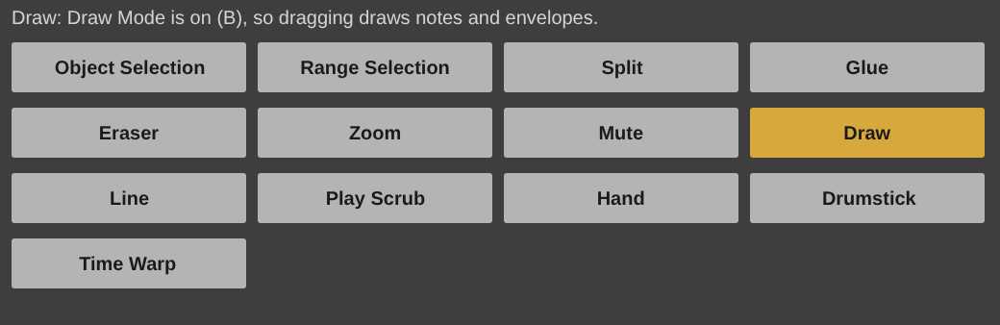

# Right-Click Toolbox for Ableton Live

A Max for Live MIDI effect. Live keeps its mouse to itself - no device can change what a click in the Arrangement does - so this keeps the toolbox, not the trick: the same thirteen tools in the same order, each doing the nearest thing Live lets a device do.

**Its colours are Live's**, after Ableton Live 8's default theme: neutral greys and one amber for what is on, so it sits beside Live's own devices. The REAPER version keeps the house scheme's yellow.

## Installing

Needs **Live 12.1 or later with Max for Live** (Live Suite, or Standard with
the add-on): the device runs on Max 9's JavaScript engine (`[v8ui]`).

1. Copy `Right-Click Toolbox.amxd`, `RightClickToolbox.js` and `RightClickToolbox.maxpat` into one folder, for
   example `Music/Ableton/User Library/Presets/MIDI Effects/Max MIDI Effect/`. The `.amxd` finds
   `RightClickToolbox.js` beside it.
2. Drag `Right-Click Toolbox.amxd` onto any MIDI track (it passes MIDI straight through).
3. Optional: open it in the Max editor and click **Freeze Device**, then save.
   The device then carries the script inside it and can be moved on its own.

## Using it

| | |
| --- | --- |
| **Object Selection, Draw** | Turn Live's Draw Mode off and on (the B key). The one in use is lit. |
| **Eraser, Mute** | Delete, or mute and unmute, the clip open in Detail View. One undo step. |
| **Glue, Drumstick** | Live joins clips with ⌘J; Glue here doubles a MIDI clip's loop. Drumstick puts the clip's notes on the sixteenths. |
| **Zoom, Play Scrub** | Zoom the Arrangement in (Option-click: out); play from the insert marker, or stop. |
| **Split, Range Selection, Line, Hand, Time Warp** | A device cannot reach these, so the tool says Live's own way: ⌘E to split, ⌘ while drawing for a line, and so on. |

A toolbox has no settings to keep.

## How it is built

`ableton/device.json` describes the device; `python3 ableton/kit/build.py
ableton/device.json` writes the `.amxd`, the `.maxpat` and the script bundle
`RightClickToolbox.js`. The bundle is the shared panel (`ableton/kit/ui.js`, `live.js`) and `ableton/toolbox.js`. No REAPER script runs here: the scripts change REAPER's mouse modifiers, which Live does not have. See `ableton/kit/VENDORED.md`.

`node --test ableton/tests/test_device.js` runs the device on a pretend Max and Live: the thirteen tools in order, Draw Mode on and off, Mute and Eraser on the open clip, Glue and Drumstick, a tool with no clip saying what to do, and Split answered with ⌘E. `node ableton/window.js` redraws the picture above from the device's own drawing code (it needs Playwright's Chromium).

## Limits

- **It has not been opened in Live yet.** It is tested in Node against a stand-in for Max and the Live Object Model; nothing has run in Max. If the `.amxd` will not open, open `RightClickToolbox.maxpat` in Max and save it as a device.
- It is a panel of buttons, not a mouse mode: the left button in Live still does what Live says.
- Zoom uses Live's zoom_view on the Arrangement; how far one click zooms is Live's choice.
